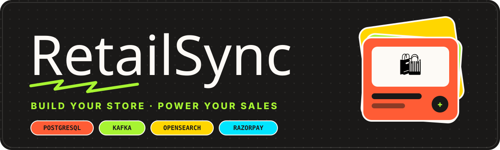

<p align="center">
  <a href="https://retailsync-sable.vercel.app/"></a>
</p>

<p align="center">
  <a href="https://retailsync-sable.vercel.app/"></a>
  <a href="https://github.com/kushalchalla981-tech/retailsync/releases/tag/v1.04"></a>
  
  
</p>

<h3 align="center">Spin up a store, sell from every branch, never oversell.</h3>

<p align="center">
  <a href="https://retailsync-sable.vercel.app/"></a>
</p>

---

## ⚡ What it does

| | |
|---|---|
| 🛍️ **Store creator** | 4-step wizard: name, business type, theme, launch. New stores appear instantly as 3D cards on the homepage. |
| 👑 **Owner dashboard** | Revenue and order KPIs, product and stock editor, order status updates, theme customizer with live preview. |
| 🤖 **AI assistant** | Ask about sales, best sellers, low stock and the live health of the cloud services. |
| 🔎 **Typo-proof search** | "sheo" still finds shoes. Fuzzy search with category, city, price and stock filters. |
| 📦 **No overselling** | Stock is locked row-by-row at checkout, so two buyers can never grab the last unit. |
| 💳 **Real checkout** | Razorpay orders are created and signature-checked on the server. UPI, cards, wallets. |
| 🔐 **Sign in** | Clerk auth; only the platform owner can manage stores. |

## 🧱 How it's built

```text
  Browser ──► Vercel (React storefront) ──/api──► Render (Fastify API)
                                                     │
                     ┌───────────────────────────────┼──────────────────────────┐
                     ▼                               ▼                          ▼
           Aiven PostgreSQL                  Aiven Apache Kafka          Aiven OpenSearch
       catalog · stock · orders       orders.placed · inventory.updated   fuzzy product search
       (SELECT … FOR UPDATE)            events → search re-index
                                                     │
                                                     ▼
                                              Razorpay (payments)
```

| Layer | Tech |
|---|---|
| Frontend | Vite · React 19 · TypeScript · Tailwind · Three.js · GSAP · Clerk |
| Backend | Fastify 5 · TypeScript · zod |
| Data | Aiven PostgreSQL · Aiven Apache Kafka · Aiven OpenSearch |
| Payments | Razorpay |
| Hosting | Vercel (storefront) · Render (API) |

## 🚀 Run it locally

```bash
npm install
cp .env.example .env            # fill in Aiven + Razorpay values
npm run test:conn               # checks PostgreSQL, Kafka, OpenSearch
npm run db:migrate && npm run seed && npm run search:init
npm run dev:backend             # API on :3000
npm run dev                     # storefront on :5174 (proxies /api)
```

The storefront also needs `VITE_CLERK_PUBLISHABLE_KEY` in `frontend/.env.local`. Without Razorpay keys, checkout simulates the payment so demos keep working.

## 🗂️ Repo map

```text
frontend/   React storefront + owner dashboard
backend/    Fastify API, Aiven connectors, migrations, seed data, tests
docs/       Pitch deck and README assets
```

## 📜 Releases

| Version | What shipped |
|---|---|
| [**v1.04**](https://github.com/kushalchalla981-tech/retailsync/releases/tag/v1.04) | Merchant shops saved in PostgreSQL with Clerk-verified ownership; live Razorpay test checkout and invoice emails. |
| [**v1.03**](https://github.com/kushalchalla981-tech/retailsync/releases/tag/v1.03) | Store-scoped merchant dashboards, emailed payment invoices, smooth scrolling in panels, WebGL-free fallback. |
| [**v1.01**](https://github.com/kushalchalla981-tech/retailsync/releases/tag/v1.01) | Cart, 9 currencies, universal search, full-page stores with photos, role-aware profile. |
| [**v1.00**](https://github.com/kushalchalla981-tech/retailsync/releases/tag/v1.00) | New storefront live, owner dashboard, store creator, Clerk sign-in, server-verified Razorpay checkout, all three Aiven services connected. |

<p align="center"><br><b>Built for Build Bengaluru 2.0 by Team Hourglass</b> · <a href="https://retailsync-sable.vercel.app/">retailsync-sable.vercel.app</a></p>
