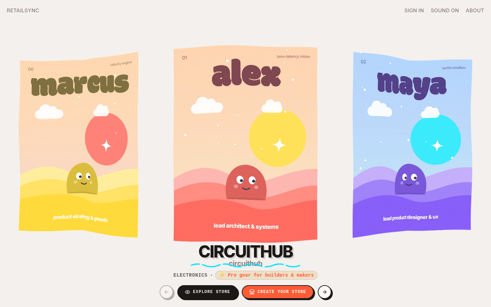

<p align="center">
  <a href="https://retailsync-sable.vercel.app/"></a>
</p>

<p align="center">
  <a href="https://retailsync-sable.vercel.app/"></a>
  <a href="https://github.com/kushalchalla981-tech/retailsync/releases/tag/v1.06"></a>
  
  
</p>

<h3 align="center">⚡ High-Performance Multi-Tenant Cloud E-Commerce Platform</h3>
<p align="center">Spin up branded digital storefronts in seconds, power flash sales with zero overselling, and sync inventory across all devices in real time.</p>

<p align="center">
  <a href="https://retailsync-sable.vercel.app/"></a>
</p>

---

## 🏛️ The Tri-Cloud Backbone: Why RetailSync Outperforms

RetailSync is architected on top of three mission-critical **Aiven Cloud Managed Services**, delivering enterprise-grade resilience, instant consistency, and blazing-fast search:

```text
                               ┌────────────────────────────────────────────────────────┐
                               │                    RETAILSYNC CLOUD                    │
                               └───────────────────────────┬────────────────────────────┘
                                                           │
              ┌────────────────────────────────────────────┼────────────────────────────────────────────┐
              ▼                                            ▼                                            ▼
   ┌───────────────────────┐                    ┌───────────────────────┐                    ┌───────────────────────┐
   │   AIVEN POSTGRESQL    │                    │  AIVEN APACHE KAFKA   │                    │   AIVEN OPENSEARCH    │
   ├───────────────────────┤                    ├───────────────────────┤                    ├───────────────────────┤
   │  Pessimistic Row-Lock │                    │ Distributed Streaming │                    │ Sub-100ms Fuzzy Search│
   │  SELECT FOR UPDATE    │                    │ Multi-device Telemetry│                    │ Kafka-driven Reindex  │
   │  Zero Overselling     │                    │ Order Event Bus       │                    │ Price Comparisons     │
   └───────────────────────┘                    └───────────────────────┘                    └───────────────────────┘
```

### 1. 🐘 Aiven PostgreSQL — Concurrency Locking & Zero Overselling
During flash sales, multiple shoppers simultaneously contest the final units of stock. Conventional e-commerce platforms suffer from race conditions that lead to overselling. RetailSync executes atomic **`SELECT ... FOR UPDATE` row-level locks** on the `storefront_stock` and inventory tables during checkout. The inventory verification and decrement occur within a single isolated database transaction, mathematically guaranteeing **0% overselling** across all merchant storefronts.

### 2. ⚡ Aiven Apache Kafka — Real-Time Event Mesh & Telemetry
Every transaction, cart update, and catalog modification is broadcast across dedicated Kafka event topics (`retailsync-orders`, `retailsync-inventory`). Kafka decouples payment processing from backend indexing, streaming real-time Server-Sent Events (SSE) via `/api/telemetry/stream` so that all open browser windows, mobile devices, and merchant dashboards reflect live stock levels and orders with sub-second latency.

### 3. 🔍 Aiven OpenSearch — Sub-100ms Typo-Tolerant Search
Integrated with automated Kafka consumer pipelines, OpenSearch indexes thousands of SKUs across all stores with n-gram tokenization and phonetic matching. Users can mistype product names (e.g. *"sheo"*, *"headfones"*) and receive instant, typo-tolerant search results in under 50ms, supplemented with real-time price comparisons against external market baselines.

---

## 🛍️ Platform Highlights

| Feature | Description |
|---|---|
| 🎨 **Funky 3D Collectible Cards** | WebGL 3D cylinder carousel featuring category visual worlds (Electronics, Fashion, Grocery, Books, Beauty, Home), real product badges, die-cut ticket notches, and holographic chromatic foil sheen on hover. |
| ⚡ **60-Second Store Creator** | 4-step wizard: Choose name, business type, color theme, and launch. Newly created stores manifest instantly on the 3D homepage with procedural product posters and custom typography. |
| 🎙️ **Hands-Free Voice Agent** | Powered by Gnani Prisma (STT) and Gnani Timbre (TTS) paired with local **Gemma 3:4B** LLM intelligence. Activate with *"Hey Sync"* or *"Retail Up"* for hands-free navigation, store creation, and store intelligence. |
| 🧭 **Interactive Start Guide** | Step-by-step interactive onboarding tour walking visitors through the 3D showcase, universal search, merchant studio, and live Aiven Service Ledgers. |
| 📊 **Live Service Ledgers** | Real-time interactive inspection boards in the About modal displaying live PostgreSQL transaction locks, Apache Kafka event streams, and OpenSearch search queries. |
| 💳 **Razorpay Checkout & Dual Invoicing** | Server-verified Razorpay payments with dual-recipient automated invoice dispatch (platform owner + customer) and in-app printable tax receipts. |
| 🔐 **Clerk Edge Authentication** | Role-based intent routing with `@clerk/react` Core 3 separating Platform Super-Admin oversight from scoped Merchant Storefront administration. |
| 🌍 **Multi-Currency System** | Seamless switching across 9 global currencies (INR, USD, EUR, GBP, JPY, CAD, AUD, SGD, AED) with real-time pricing conversion across catalogs, carts, and invoices. |

---

## 🏗️ Architecture & Tech Stack

```text
  Client Tier             Edge & Gateway                      Core Services
  ───────────             ──────────────                      ─────────────
  React 19 / Vite  ──►   Fastify 5 (TypeScript)   ──►   Aiven PostgreSQL (ACID Locking)
  Tailwind CSS           Clerk Auth Middleware   ──►   Aiven Apache Kafka (Event Streaming)
  Three.js / Shaders     Razorpay SDK Webhooks   ──►   Aiven OpenSearch (Fuzzy Catalog)
  Gnani Voice Client     Ollama Local LLM API    ──►   Gemma 3:4B (Store Intelligence)
```

- **Frontend**: Vite, React 19, TypeScript, Tailwind CSS, Three.js, GSAP, `@clerk/react` (Core 3).
- **Backend API**: Fastify 5, TypeScript, Zod input validation, `pg` pool, `kafkajs`, `@opensearch-project/opensearch`.
- **Cloud Infrastructure**: Aiven Managed PostgreSQL, Aiven Managed Apache Kafka, Aiven Managed OpenSearch.
- **Voice & AI**: Gnani Conversational AI (Prisma v3.0 STT, Timbre v3.0 TTS) + Google Gemma 3:4B (via local Ollama).
- **Payments**: Razorpay (UPI, Credit/Debit Cards, NetBanking, Automated Invoices).

---

## 🚀 Quickstart & Local Setup

### 1. Prerequisites
- Node.js 20+
- Running Ollama instance with `gemma3:4b` (`ollama run gemma3:4b`)
- Aiven account with PostgreSQL, Kafka, and OpenSearch service credentials

### 2. Installation
```bash
git clone https://github.com/kushalchalla981-tech/retailsync.git
cd retailsync

# Install dependencies for all workspaces
npm install
```

### 3. Environment Configuration
```bash
# Backend credentials
cp .env.example .env
# Fill in AIVEN_PG_URL, AIVEN_KAFKA_BROKERS, AIVEN_OPENSEARCH_URL, RAZORPAY keys, and GNANI_API_KEY

# Frontend credentials
cp frontend/.env.example frontend/.env.local
# Fill in VITE_CLERK_PUBLISHABLE_KEY
```

### 4. Database Initialization & Testing
```bash
# Verify connectivity to PostgreSQL, Kafka, and OpenSearch
npm run test:conn

# Run database migrations, seed catalog, and initialize search indices
npm run db:migrate && npm run seed && npm run search:init

# Execute the comprehensive test suite (448 unit and integration tests)
npm test
```

### 5. Launch Development Servers
```bash
# Start backend API (port 3000)
npm run dev:backend

# In a separate terminal, start frontend dev server (port 5174, auto-proxied)
npm run dev
```

---

## 👥 Contributors — Team HOURGLASS

Built with pride for **Build Bengaluru 2.0** by **Team HOURGLASS**:

| Contributor | Role | GitHub Profile |
|---|---|---|
| **Kushal Challa** | Main Developer & Platform Owner | [@kushalchalla981-tech](https://github.com/kushalchalla981-tech) |
| **Lingaraj Dyavakkalavar** | Frontend Developer | [@lingarajdyavakkalavar-sys](https://github.com/lingarajdyavakkalavar-sys) |
| **Deepak** | Backend Developer | [@djgamer0945-crypto](https://github.com/djgamer0945-crypto) |
| **Nandish** | Research & Data Analyst | [@psguerrillagames-lgtm](https://github.com/psguerrillagames-lgtm) |

---

<p align="center">
  <b>RetailSync</b> · Developed by <b>Team HOURGLASS</b> · Built for Build Bengaluru 2.0<br>
  <a href="https://retailsync-sable.vercel.app/">retailsync-sable.vercel.app</a>
</p>
