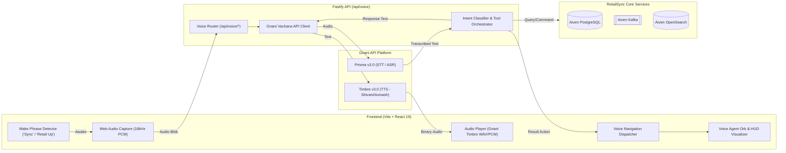

# RetailSync Version 1.06 Implementation Plan: Gnani AI Voice Agent

## Overview
RetailSync v1.06 introduces a fully hands-free, multilingual **Voice Agent** powered by the **Gnani API Platform** (Prisma v3.0 Streaming STT and Timbre v3.0 Neural TTS). The voice agent empowers shoppers and merchants to navigate the 3D storefront, build and launch stores via conversational voice prompts, dictate queries into the AI Assistant, and wake the agent using dedicated trigger phrases (`"Sync"`, `"Hey Sync"`, or `"Retail Up"`).

---

## Architecture & Technology Stack



---

## 1. Feature Specifications

### Feature 1: Hands-Free Voice Navigation
Enable comprehensive, zero-touch voice control across every screen and module:
- **3D Carousel & Store Navigation**:
  - *"Go to CircuitHub"* / *"Open Threadline"* / *"Show me Peel & Pour"* -> Spins the 3D cylinder to the target card and opens the full-page store dossier.
  - *"Next store"* / *"Previous store"* -> Steps through the store carousel with whoosh sound effects.
- **Platform Modules**:
  - *"Open Cart"* / *"View Cart"* / *"Close Cart"* -> Toggles the slide-over cart drawer.
  - *"Search for noise-cancelling headphones"* -> Opens Universal Search modal and populates the OpenSearch query.
  - *"Open Dashboard"* / *"Go to Merchant Studio"* -> Navigates to the administrative dashboard.
  - *"Open About"* / *"Show Kafka Ledger"* / *"Check PostgreSQL"* -> Opens About modal and launches the respective live service ledger.
  - *"Close"* / *"Go back"* / *"Escape"* -> Executes the hierarchical ESC dismiss coordinator.

---

### Feature 2: Voice-Assisted Store Creation (Voice Store Creator)
A conversational store-building co-pilot that drives the 4-step `CreateStoreModal.tsx` wizard without typing:
1. **Initiation**:
   - User says: *"Create a new store called ZenTech"* or *"I want to start a fashion brand"*.
   - Agent activates `CreateStoreModal` and populates the store name and URL slug (`/zentech`).
2. **Category Selection**:
   - Agent asks via Timbre TTS: *"What type of store is ZenTech? For example, Electronics, Fashion, or Home Decor?"*
   - User replies: *"Electronics and Tech"* -> Agent highlights and selects the category card.
3. **Theme Selection**:
   - Agent asks: *"Which theme would you like? We have Aurora, Sunset, Forest, Midnight, and Obsidian."*
   - User replies: *"Aurora"* -> Agent selects the Aurora cyan/purple palette.
4. **Voice Confirmation & Launch**:
   - Agent summarizes: *"ZenTech is ready in Electronics with the Aurora theme. Shall I launch it now?"*
   - User says: *"Yes, launch it!"* / *"Deploy store"* -> Wizard executes `createStore()`, saves to Aiven PostgreSQL, and the new store card manifests on the 3D homepage carousel.

---

### Feature 3: Voice Dictation & AI Assistant Co-Pilot
Hands-free interaction with the RetailSync Intelligence Assistant:
- **Voice-to-Text Query Input**:
  - In `AIAssistant.tsx`, a microphone toggle allows dictating queries in English or code-mixed Hindi/Hinglish.
  - Transcribed speech feeds directly into the AI prompt bar.
- **Spoken AI Responses (Gnani Timbre)**:
  - Query: *"What is the price of sunglasses?"*
  - AI Assistant computes domain response from PostgreSQL catalog: *"Classic Sunglasses in Threadline is priced at ₹1,999 with 88 units in stock."*
  - Spoken output is synthesized using Gnani Timbre (`voice: "Shivani"` / `"Avinash"`, `model: "timbre-v3.0"`) and streamed to the user's speakers.

---

### Feature 4: Wake-Up Phrase Detection (`"Sync"` / `"Hey Sync"` / `"Retail Up"`)
Hands-free activation without requiring button clicks:
- **Wake Word Engine**:
  - Continuous listening state using low-power browser speech recognition / energy threshold detecting trigger phrases:
    - `"Sync"`
    - `"Hey Sync"`
    - `"Retail Up"`
- **Visual & Audio Feedback**:
  - **Wake Chime**: Plays an immediate activation chime (`sound.playWhoosh`).
  - **Voice Agent Orb**: Floating HUD in the bottom-right corner pulses with an energetic gradient wave (`#00e5ff` cyan / `#ff5c35` coral).
  - **Status Indicator**: Displays current state: `STANDBY (Say "Hey Sync")` $\to$ `LISTENING...` $\to$ `PROCESSING...` $\to$ `SPEAKING`.
  - **Barge-in / Cancel**: Saying *"Stop"*, *"Cancel"*, or clicking the orb halts speech immediately.

---

## 2. Technical Contracts & Implementation Details

### A. Backend Services (`backend/src/voice/`)

#### 1. Gnani Vachana API Client (`backend/src/voice/gnani-client.ts`)
- **Authentication**: Uses `X-API-Key-ID: process.env.GNANI_API_KEY` (securely loaded from `.env`, never hardcoded).
- **STT Endpoint**: `POST https://api.vachana.ai/stt/v3`
  - Accepts audio multipart form (`audio_file`, `model: "prisma-v3.0"`, `language_code: "en-IN"` or `"hi-IN"`).
  - Returns transcribed text, confidence, and language.
- **TTS Endpoint**: `POST https://api.vachana.ai/api/v1/tts/inference`
  - Body: `{ text, voice: "Shivani", model: "timbre-v3.0", language: "en" }`
  - Returns binary WAV/PCM audio stream.

#### 2. Intent Classifier & Command Dispatcher (`backend/src/voice/intent.ts`)
- Maps natural spoken phrases to structured platform actions:
  ```ts
  export type VoiceAction =
    | { type: 'NAVIGATE_STORE'; storeSlug: string }
    | { type: 'OPEN_MODULE'; module: 'cart' | 'dashboard' | 'search' | 'about' | 'ledger' }
    | { type: 'CLOSE_OVERLAY' }
    | { type: 'CREATE_STORE_INPUT'; field: 'name' | 'category' | 'theme' | 'submit'; value: string }
    | { type: 'AI_QUERY'; query: string };
  ```

#### 3. Voice API Routes (`backend/src/routes/voice.ts`)
- `POST /api/voice/transcribe`: Accepts audio blob, returns transcribed text from Gnani Prisma.
- `POST /api/voice/synthesize`: Accepts text, returns audio stream from Gnani Timbre.
- `POST /api/voice/action`: Accepts user transcript, returns classified action + spoken response.

---

### B. Frontend Components (`frontend/src/components/voice/`)

#### 1. Voice Agent Orb (`frontend/src/components/voice/VoiceAgentOrb.tsx`)
- Sleek neo-brutalist floating action button with expandable voice HUD.
- Features real-time audio waveform visualizer (canvas-based).
- Shows live transcription captions and spoken agent feedback.

#### 2. Voice Controller Hook (`frontend/src/hooks/useVoiceAgent.ts`)
- Manages microphone permissions and audio stream recording (16kHz linear PCM).
- Handles wake-phrase detection (`"Hey Sync"`, `"Retail Up"`, `"Sync"`).
- Dispatches actions to `App.tsx`, `CartContext`, and `storeManager`.

---

## 3. Security & Git Policy
> [!CAUTION]
> The Gnani API Key (`vach_…`) MUST NOT be committed to git.
> It will be configured exclusively in `.env` / `frontend/.env.local` (both guarded by `.gitignore`).

---

## 4. Verification Plan

### Automated Checks
- `cd backend && npm test`: Ensure existing 311 unit tests pass and new voice service tests succeed.
- `cd frontend && npm run build`: Verify TypeScript compilation with 0 errors.

### Manual Voice Scenarios
1. **Wake Phrase Test**:
   - Say *"Hey Sync"* -> Verify Voice Orb wakes up with visual glow and chime.
2. **Navigation Test**:
   - Say *"Go to Threadline"* -> Verify carousel navigates to Store 2 and opens the dossier.
   - Say *"Open Cart"* -> Verify CartDrawer slides in.
   - Say *"Close"* -> Verify CartDrawer dismisses.
3. **Store Creation Test**:
   - Say *"Create store named Zenith"* -> Wizard opens with name prefilled.
   - Say *"Choose Electronics"* -> Category set.
   - Say *"Select Aurora"* -> Theme set.
   - Say *"Launch store"* -> New store created and appears on homepage.
4. **AI Dictation & TTS Test**:
   - In AI Assistant, say *"What is the price of sunglasses?"* -> Assistant receives transcript, answers, and speaks back via Gnani Timbre.
