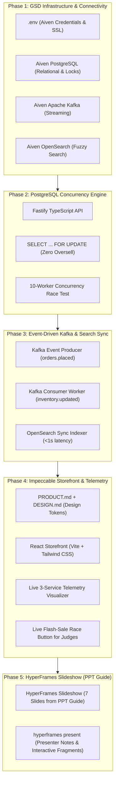

# Master Execution Plan: RetailSync Online Store & Live Pitch Deck

This execution plan synthesizes **GSD** (systematic phase/plan orchestration, atomic git commits, verification), **Impeccable** (high-craft UI design system, typography, telemetry dashboard, detector checks), and **HyperFrames** (interactive 7-slide pitch deck adhering to `PPT Guide .pdf`).

---

## 1. Architectural Blueprint & Skill Integration

---

## 2. Phase-by-Phase Execution Roadmap

### Phase 1: Cloud Foundation & Connectivity Baseline (GSD)
- **Goal**: Scaffold the TypeScript monorepo/workspace, configure secure environment handling for Aiven services with SSL, create migrations/schemas, and build the unified diagnostics and seed tool.
- **Plans**:
  1. `01-01`: Scaffolding, `.env.example`, and typed Aiven connection singletons (`backend/src/services/{postgres,kafka,opensearch}.ts`).
  2. `01-02`: Database migrations (`schema.sql`), OpenSearch index mapping with fuzzy edge-ngram analyzers, and Kafka topic provisioning (`orders.placed`, `inventory.updated`).
  3. `01-03`: Unified connectivity test suite (`npm run test:conn`) and 50+ item catalog/inventory dual-sync seeder (`npm run seed`).

### Phase 2: PostgreSQL Store Engine & Concurrency Locking (GSD Core Engine)
- **Goal**: Build Fastify REST APIs for categories, products, carts, and implement atomic order placement with row-level pessimistic locking (`SELECT ... FOR UPDATE`) to strictly prevent overselling.
- **Plans**:
  1. `02-01`: REST APIs for catalog browsing, location selection, cart sessions, and inventory lookup.
  2. `02-02`: Atomic checkout transaction with pessimistic locking, stock deduction, and an automated concurrency test suite simulating 10 simultaneous checkouts on a single remaining item.

### Phase 3: Event-Driven Kafka Pipeline & OpenSearch Sync (GSD Eventing)
- **Goal**: Wire real-time event publishing and consumption to keep inventory and OpenSearch synchronized with sub-second latency.
- **Plans**:
  1. `03-01`: Kafka producer emitting `orders.placed` on checkout; consumer worker listening to events and emitting `inventory.updated`.
  2. `03-02`: OpenSearch sync consumer indexing inventory deltas in real-time; search API `/api/search` supporting fuzzy typo tolerance (`fuzziness: "AUTO"`), multi-field queries, and faceted filters (city, price, category).

### Phase 4: Modern Storefront UI & Live Telemetry Inspector (Impeccable + GSD)
- **Goal**: Build an e-commerce storefront and live judge inspector adhering to the Impeccable design system.
- **Plans**:
  1. `04-01`: Design system setup (`PRODUCT.md`, `DESIGN.md`), responsive React storefront (catalog grid, instant fuzzy search bar with debounce, faceted filter drawer, cart drawer, checkout modal).
  2. `04-02`: Live "All 3 Services in Action" inspector panel displaying real-time PostgreSQL transactions, streaming Kafka event logs, and OpenSearch sync latency, plus an interactive "Simulate Flash Sale Race" demo trigger.
  3. `04-03`: Impeccable audit pass (`impeccable detect --json`) ensuring typography hierarchy, contrast ratios, smooth animations, and zero layout shift.

### Phase 5: HyperFrames Slideshow Pitch Deck (HyperFrames + PPT Guide)
- **Goal**: Build an interactive, live presentation deck using HyperFrames Slideshow strictly structured according to `PPT Guide .pdf`.
- **Slides Structure**:
  1. **Slide 1: Title**: Project Title (*RetailSync*), Theme (*Aiven Cloud E-Commerce*), Team Details.
  2. **Slide 2: Problem + Existing Gap**: The transition from offline retail to online e-commerce; stock desynchronization and overselling under concurrent rush; slow/rigid search.
  3. **Slide 3: Proposed Solution**: Event-driven architecture with PostgreSQL ACID locks as single source of truth, Apache Kafka for decoupled real-time event streaming, and OpenSearch for typo-tolerant product discovery.
  4. **Slide 4: Architecture + Tech Stack**: End-to-end data flow (Input → Process → Output) with Aiven PostgreSQL, Kafka, OpenSearch, Fastify, and React.
  5. **Slide 5: Key Features**: Strict 0% overselling concurrency lock, sub-100ms typo-tolerant search, real-time event streaming, and live 3-service telemetry inspector.
  6. **Slide 6: Impact + Feasibility**: Scalability with managed Aiven cloud services, cost efficiency, and real-world enterprise retail applicability.
  7. **Slide 7: Demo + Conclusion**: Interactive demo link, live test results, and concluding argument on why RetailSync satisfies all hackathon criteria.
- **Plans**:
  1. `05-01`: Build HyperFrames Slideshow composition (`deck/index.html`, scenes, presenter notes, fragments, and JSON island).
  2. `05-02`: Validate with `npx hyperframes check --json` and test with `npx hyperframes present`.
  3. `05-03`: Author final README with demo script, pitch script, and architecture diagrams.

---

## 3. Immediate Next Steps

1. Begin **Phase 1 Plan 01-01**: Initialize the TypeScript workspace, install dependencies, create `.env.example`, and implement Aiven connection singletons with SSL support.
2. Proceed to **Plan 01-02**: Run PostgreSQL database migrations and initialize OpenSearch and Kafka schemas.
3. Proceed to **Plan 01-03**: Run seed scripts and verify connectivity.
